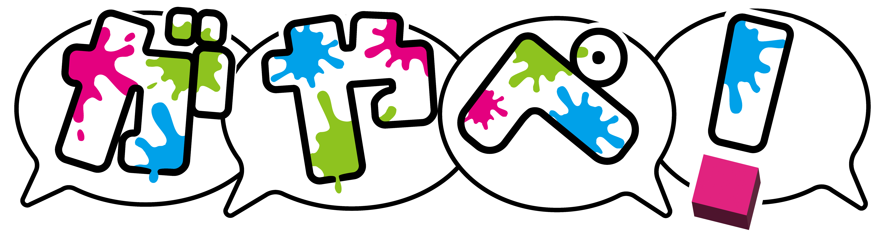

# がやぺ！



**仲間のエピソードに「なるほど！」と相槌を打つと、教室にインクが広がる。** 「がやぺ！」は、声で陣地を塗り合うブラウザ向けのオンライン3Dパーティーゲームです。ハッカソンのテーマ「らしさ」から、Life is Tech! の大学生メンターが合いの手やリアクションで仲間の話を盛り上げる「ガヤ」の文化を、初対面でも楽しめる遊びにしました。

## 遊び方

1. **集まる。** 1人1台のPCで、作成者が人数（2・4・6・8人）を選び、参加リンクか招待コードを共有します。仲間の声を聞くには Discord や Zoom などの通話を併用します。ヘッドホン推奨です。
2. **話す準備をする。** ロビーで各自がエピソードを入力し、マイクをオンにして「準備OK」を押します。話題に迷ったら、お題のヒントを使えます。全員が揃ったら均等な2チームに分かれ、作成者がチームカラーとトーク時間（10〜60秒、初期値30秒）を選びます。
3. **話す・聞く・塗る。** 両チームから交互に1人ずつ発表します。聞き手は教室を駆け回り、話にガヤを入れて自チームのインクを広げます。WASDで移動、マウスで視点操作、Spaceでジャンプ。自分の色の床ではShiftを押している間、インクに潜って速く移動できます。
4. **結果を見る。** 全員が話し終わったとき、床に自分の色を多く残したチームの勝ちです。同面積なら引き分け。結果画面には、塗られた床のうち各チームが占めた割合が表示されます。

## こだわったところ

### 「その人らしいガヤ」が見える演出

- **相槌は軽快に、長い返しは豪快に。** 短い相槌ではキューブがぎゅっと縮み、跳ねながら扇状にインクを飛ばします。話題に沿った長い返答では、回転ジャンプからの着地で周囲を一気に塗る「インクスラム」が発動します。仲間への返し方で、技のリズムも変わります。
- **塗りたてのインクの質感。** チームカラーの上に濡れたような光沢を重ね、インクの縁には厚みを、表面には細かい波打ちを描きました。視点を動かすと光の反射が変わり、床に残った一滴まで見分けられます。
- **話す人にも、聞く人にも見せ場を。** ガヤが入ると発表者のスポットライトも反応します。2対2以上では、発表者が話に集中できるよう、聞き手が1人減るチームの塗り面積を人数比で補います。2対2なら味方の塗りは約2倍です。
- **着せ替えも会話のきっかけに。** 同じキューブでも、いつものメガネを掛ける人、頭にプリンを載せる人、背中にゼンマイを付ける人で印象は変わります。ロビーでは3Dプレビューを回し、仲間からどう見えるかを確かめて選べます。

### 会話に集中できるUI

- **入室と準備。** インクの飛沫と斜めのボタンで、入口からゲームの雰囲気を伝えます。「ルームを作る」「ルームに入室する」の二択で始まり、ロビーでは「準備OK」に足りない項目が強調されるので、次に何をすればよいか分かります。
- **話す番とガヤを入れる番。** ターンの切り替わりには、発表者には「次はあなたのターン」、聞き手には発表者名と「ガヤを入れて盛り上げよう！」を表示します。発表中も話題と残り時間を確認でき、途中で話を拾った人もガヤに加われます。
- **みんなで振り返る結果画面。** 試合と同じインク色のゲージで陣地の割合を見せ、最後に塗られたフィールドを上から表示します。僅差の勝負でも、どこを塗り返したかを指しながら盛り上がれます。

### 体験を支える技術と選定理由

| 実現したかったこと | 選んだ技術と理由 |
| --- | --- |
| 「うん、うん」のテンポで塗る | **Web Speech API** は発話途中の文字を取得できるため、既知の相槌は文末を待たずに1回ずつ発射できます。確定時には同じ相槌の二重発射を防ぎます。 |
| 日本語の返しと話題のつながりを拾う | **reaction-evaluator と Ruri v3 30m** で、返答と発表中の話題の意味の近さを判定します。日本語専用の軽量モデルを選び、限られたサーバーメモリで動かせるようにしました。 |
| 教室・インク・着せ替えを5人で作る | **React、Three.js、React Three Fiber** を使い、画面と3Dの各部品を分担できる構成にしました。**TypeScript** でクライアントとサーバーの通信の型を共有し、受信データを **Zod** で検証します。 |
| 全員が同じ陣地で競う | **Node.js と Colyseus** はルーム管理と状態の差分同期を備えています。サーバーが2048 × 2048セルの所有色を管理し、その結果から全員の勝敗を決めます。ガヤの判定リクエストは **Express** で受けます。 |
| 短期間で公開し、離れた場所から対戦を試す | Web画面とリアルタイム対戦用のWebSocketサーバーをまとめて管理でき、公開手順を簡潔に保てるため、**Render** を選びました。初期公開には無料枠を採用し、各メンバーの端末から費用をかけずに接続を試せる構成にしました。 |

開発環境は npm workspaces でまとめ、Webの開発・ビルドには Vite、ゲームルールや判定処理のテストには Vitest を使っています。

マイクは HTTPS または localhost で許可して使います。Web Speech API はブラウザ提供元のサービスで音声を処理する場合があります。ゲームサーバーへ送るのは文字起こしなどの判定用データで、音声ファイルは送信しません。[音声の取り扱い](./docs/web-speech-privacy.md)

## ローカルでの起動

Node.js 24 と npm を用意し、リポジトリ直下で実行します。nvm を使う場合は、先に `nvm use` でバージョンを合わせてください。

```bash
npm ci
npm run dev
```

Web とゲームサーバーが一緒に起動します。[ゲームを開く](http://localhost:5173) ／ [サーバーの起動を確認](http://localhost:2567/health)

- **1人で試す** — [検証モード](http://localhost:5173/?dev)で、ガヤの演出や試合進行を確認できます。
- **接続先を変える** — [環境変数の例](./apps/web/.env.example)を `apps/web/.env` にコピーし、`VITE_SERVER_URL` を設定します。ガヤ判定用のAPIキーは不要です。判定モデルの初回取得にはインターネット接続が必要です。
- **動作を検査する** — `npm run typecheck`、`npm test`、`npm run build`、`npm run lint` を使用します。
- **公開する** — Render で [render.yaml](./render.yaml) から Blueprint を作成し、Web を Static Site、ゲームサーバーを Web Service として配置します。デモ前にサーバーの `/health` で起動を確認してください。ルームはメモリ上にあり、サーバー再起動時に消えます。

## 素材のクレジット

### ロゴ

- 「がやぺ！」のロゴ（[apps/web/src/assets/images](./apps/web/src/assets/images)）は、開発メンバーの TK が制作しました。

### AI モデル

| 用途 | モデル | 提供元 | ライセンス |
| --- | --- | --- | --- |
| ガヤ判定（文章の意味の近さ） | [Ruri v3 30m](https://huggingface.co/cl-nagoya/ruri-v3-30m) | CL Research Group in Nagoya（cl-nagoya） | Apache License 2.0 |
| 上記の ONNX 変換版（実際に読み込むファイル） | [ruri-v3-30m-ONNX](https://huggingface.co/sirasagi62/ruri-v3-30m-ONNX) | sirasagi62 | Apache License 2.0 |
| ブラウザ内の文字起こし（検証用） | [whisper-tiny](https://huggingface.co/onnx-community/whisper-tiny)・[whisper-base](https://huggingface.co/onnx-community/whisper-base)（ONNX 版） | ONNX Community（元モデル：[OpenAI Whisper](https://huggingface.co/openai/whisper-tiny)） | 元モデルは Apache License 2.0。whisper-base の ONNX 版は Apache License 2.0、whisper-tiny の ONNX 版にはライセンスの記載がありません |

- Ruri: Hayato Tsukagoshi, Ryohei Sasano. "Ruri: Japanese General Text Embeddings." arXiv:2409.07737, 2024.
- Whisper: Alec Radford et al. "Robust Speech Recognition via Large-Scale Weak Supervision." arXiv:2212.04356, 2022.

### ライブラリと辞書

- **[Transformers.js](https://github.com/huggingface/transformers.js)**（@huggingface/transformers 3.8.1）— Hugging Face, Apache License 2.0。ブラウザとサーバーで上記のモデルを動かすのに使っています。
- **[kuromoji.js](https://github.com/takuyaa/kuromoji.js)**（0.1.2）— Takuya Asano, Apache License 2.0。ガヤ判定ライブラリ（reaction-evaluator）が、発言と元の話を単語に分けるのに使います。
- **mecab-ipadic-2.7.0-20070801**（kuromoji.js に同梱の辞書）— Copyright 2000, 2001, 2002, 2003 Nara Institute of Science and Technology. All Rights Reserved. 著作権表示と免責条項の全文は `node_modules/kuromoji/NOTICE.md` に収録されています。

ガヤ判定ライブラリ reaction-evaluator（[vendor](./vendor)）はチームで作成したものです。

## 開発メンバー

| メンター名 | 役割 |
| --- | --- |
| わきそう | 全体の実装、Git管理、デプロイ、システムの微調整 |
| みすたー | 全体の実装（特に音声処理）、デザイン・アイデアの具体化 |
| さとたい | UI改善、チームのマネジメント、テスト |
| ゆっちん | UIのアイデア出し、細部の実装、発表資料の作成、ユーザーテストの実施 |
| TK | ロゴ・UIデザイン、発表資料・動画の作成、テスト |

## 開発の1週間

| 日付 | 主な取り組み |
| --- | --- |
| 11/15 | メンターのガヤ文化を題材に、発表と陣取りを組み合わせる遊び方を整理。ブラウザ向け3Dゲームの技術方針を決定。 |
| 11/16 | ゲームサーバーと招待リンクを用意し、同じフィールドで移動・塗り・潜航ができるようにした。着地で塗る必殺技も試作。 |
| 11/17 | フィールドを広げ、プレイヤーに名前を表示。塗った床に潜る操作を調整。 |
| 11/18 | ブラウザ内で日本語の文字起こしを試作。話題のヒント、チーム編成、発表者側の塗り補正を追加。 |
| 11/19 | 途中認識した相槌と話題に沿った返答を技に接続。教室ステージ、濡れたインクの質感、スポットライト、着せ替えを実装。 |
| 11/20 | ロゴと入室・準備画面を仕上げ、人数選択とチーム交互の発表順を反映。1対1の塗りと、試合開始直後に動けなくなる不具合を修正。 |

設計の経緯とチームの開発ルールは [AGENTS.md](./AGENTS.md) に記録しています。
